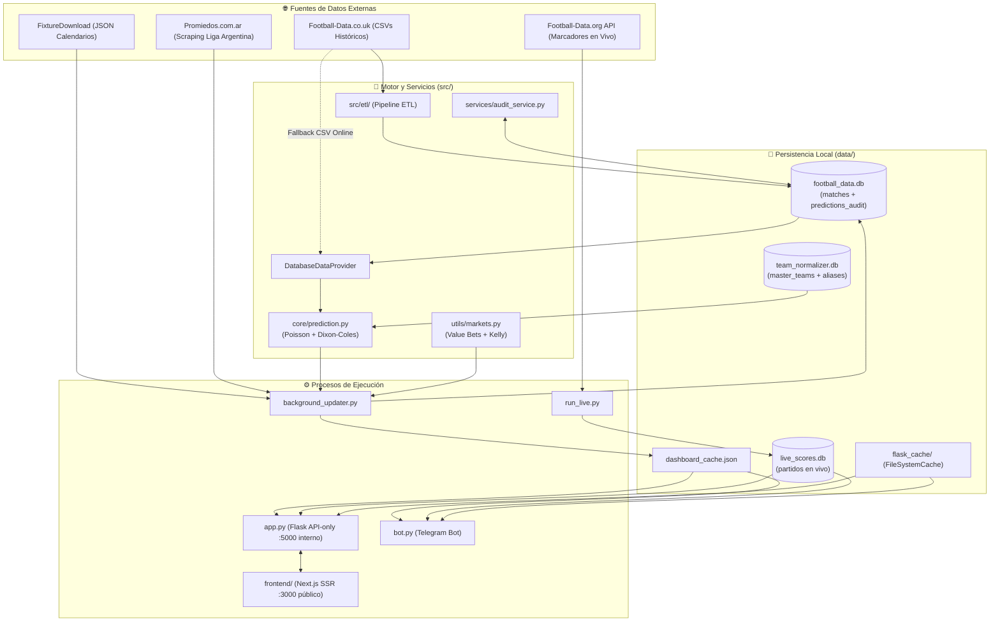

# 🏗️ Arquitectura del Sistema - Timba Predictor v3.0

Este documento describe la arquitectura modular (Frontend Next.js SSR + Backend Flask API-only), el flujo de datos, el esquema de persistencia SQLite y las estrategias de resiliencia de **Timba Predictor**.

---

## 🔄 Flujo de Datos General

---

## 📦 Responsabilidad por Paquete (`src/` y `frontend/`)

| Paquete / Módulo | Responsabilidad Principal |
|---|---|
| `frontend/` | Aplicación web **Next.js (App Router, TypeScript, SSR)** con React-Bootstrap, `useSWR` para marcadores en vivo y proxy same-origin de `/api/*` hacia Flask. |
| `src/config/leagues.py` | Fuente canónica de las 9 competiciones (`LIGAS`, `URLS_FIXTURE`, `CSV_A_LIGA_ID`). |
| `src/core/prediction.py` | Cálculo vectorizado de fuerzas (`calcular_fuerzas`), modelo Poisson + ajuste Dixon-Coles (`predecir_partido`), Champions inter-liga (`predecir_partido_champions`) y motor In-Play (`predecir_partido_en_vivo`). |
| `src/utils/markets.py` | Cálculo de mercados derivados (Over/Under, BTTS, Córners, Tarjetas, Doble Oportunidad), Valor Esperado ($\text{EV}$) y Criterio de Kelly. |
| `src/utils/shared.py` | Rutas centralizadas (`DB_PATH`, `LIVE_SCORES_DB_PATH`, `TEAM_NORMALIZER_DB_PATH`), conexiones SQLite en modo WAL (`get_db_connection`), normalización de columnas CSV (`normalizar_csv`), descarga resiliente (`descargar_csv_safe`) y `ALIAS_TEAMS`. |
| `src/db_data_provider.py` | Proveedor inteligente con prioridad **BD Local (`matches`) → CSV Online normalizado**. |
| `src/etl/` | Pipeline ETL modular (`extractor.py`, `transformer.py`, `loader.py`, `pipeline.py`) invocado desde `src/etl_football_data.py`. |
| `src/scrapers/fixtures_scraper.py` | Obtención de próximos partidos desde feeds JSON de FixtureDownload y scraping de Promiedos (Next.js). |
| `src/services/` | Capa de servicios desacoplada para predicciones, caché SWR en memoria y precalentamiento asíncrono (`prediction_service.py`), fixtures/enriquecimiento (`fixtures_service.py`) y auditoría histórica (`audit_service.py`). |
| `src/web/` | Backend API REST JSON (`blueprints/api.py`) y caché compartido (`cache.py`). |
| `src/bot/` | Bot interactivo de Telegram (`bot_app.py`, `handlers.py`, `formatters.py`). |
| `src/analytics/backtester.py` | Motor de simulación histórica walk-forward (Brier Score, ROI/Yield, Max Drawdown). |
| `src/timba_core.py` | Fachada de retrocompatibilidad y caché LRU en memoria (`_get_cached_historical_data`). |

---

## 💾 Esquema de Bases de Datos (`data/databases/`)

Todas las conexiones SQLite utilizan `get_db_connection()` con:
- `PRAGMA journal_mode = WAL;` (lecturas y escrituras concurrentes sin bloqueos)
- `PRAGMA synchronous = NORMAL;`
- `PRAGMA busy_timeout = 5000;`

### 1. `football_data.db`
Contiene dos tablas principales:
- **`matches`**: Poblada por el pipeline ETL (`python -m src.etl_football_data`). Almacena el historial de partidos normalizados por liga (`league_code`, `temporada`, `date`, `home_team`, `away_team`, `fthg`, `ftag`, `ftr`, tiros, córners, tarjetas y cuotas Bet365).
- **`predictions_audit`**: Creada y migrada automáticamente por `background_updater.py` (`init_audit_db`) y `audit_service.py`. Registra las predicciones pre-partido (`prob_local`, `prob_empate`, `prob_visitante`, `prediccion_1x2`, `guardado_at`) y luego contrasta con el marcador real (`resultado_real`, `goles_local`, `goles_visitante`, `acierto_1x2`, `resultado_registrado_at`).

### 2. `team_normalizer.db`
Gestionada por `src/team_normalization.py`. Almacena equipos maestros (`master_teams`) y alias (`team_aliases`) filtrados por `league_code` para evitar colisiones de nombres entre ligas.

### 3. `live_scores.db`
Gestionada por `src/live_scores.py` y actualizada por `run_live.py`. Guarda el estado de los partidos en vivo y marcadores del día.

---

## 🛡️ Estrategia de Resiliencia y Fallbacks

1. **Datos Históricos**:
   - **Nivel 1 (Óptimo)**: Consulta SQL sobre la tabla `matches` en `football_data.db`.
   - **Nivel 2 (Fallback automático)**: Si la tabla `matches` no existe o no tiene registros para la liga solicitada, `DatabaseDataProvider` descarga el CSV oficial desde `football-data.co.uk` y normaliza sus columnas con `normalizar_csv()` (soportando tanto el formato europeo `HomeTeam`/`FTHG` como el formato de ligas adicionales `Home`/`HG` usado en Argentina).
2. **UEFA Champions League (`liga_id = 8`)**:
   - Al ser un torneo continental sin CSV doméstico único (`es_torneo: True`), `predecir_partido_champions()` combina las fuerzas ofensivas y defensivas de cada club en su liga doméstica ponderadas por el coeficiente competitivo de cada liga (`COEFICIENTES_LIGAS`).
3. **Caché de Fixtures en `background_updater.py`**:
   - Durante cada ciclo de actualización, los fixtures descargados en el cálculo de partidos del día se reutilizan en memoria (`cache_fixtures`) para la proyección de auditoría de los próximos 7 días, evitando duplicar peticiones HTTP y scraping.
